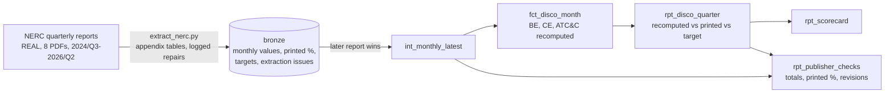

# Nigerian DisCo Performance Scorecard

[](https://github.com/Saigwe/nigeria-disco-performance/actions/workflows/ci.yml)

> Billing efficiency, collection efficiency and ATC&C loss for all eleven Nigerian electricity distribution companies, month by month from April 2024 to June 2026, extracted from the regulator's own quarterly reports. Every figure is recomputed from the money and checked against what NERC printed; my ATC&C matches NERC's within 0.15pp, and the checks surface 18 places where the reports don't add up.

**Author:** Stanley Igwe, Lead Data (Analytics) Engineer · [Portfolio](https://saigwe.github.io)
**Stack:** Python · pdfplumber · DuckDB · dbt Core · [dbt-trust-tests](https://github.com/Saigwe/dbt-trust-tests) · GitHub Actions
**Status:** ✅ Built on 8 real NERC reports. `dbt build` 16/16, pytest 4/4, CI downloads the reports and rebuilds everything.

I spent five years at Ikeja Electric, one of the eleven DisCos here. As its business intelligence analyst I reported billing efficiency, collection efficiency and outstanding balances on priority feeders and modelled the revenue from metering high-loss feeders. Before that, as engineering data analyst, my SQL analysis of smart-meter and vending data recovered NGN 5M in three months. This project builds the sector-wide view of the same measures from public data. No employer data is used.

---

## 90-second summary
| | |
|---|---|
| **Problem** | NERC publishes the sector's commercial performance as tables inside 90-page PDFs, one quarter at a time. You can't see a DisCo's trend, compare it with its target, or tell whether a loss is a billing or a collection problem without retyping the tables. |
| **What I built** | An extractor that reads the appendix tables from 8 reports into one monthly dataset, repairing malformed numbers only by logged rules; dbt models that recompute every efficiency from the naira and energy figures, compare them with the printed percentages and the MYTO targets, and build a scorecard; checks on the regulator's own totals. |
| **Why it matters** | A board, investor or regulator can see each DisCo's loss against its target, whether to spend on metering (billing loss) or enforcement (collection loss), and which printed figures to trust. |
| **Proof** | In Q2 2026 no DisCo met its target: the sector lost 36.3% (ATC&C) against targets of 13.5–29%. Over the last four quarters that is ₦1,325bn of energy value not recovered: ₦724bn to billing losses, ₦601bn to unpaid bills. See [Numbers](#numbers). |

## Architecture


## Data
Eight [NERC quarterly reports](https://nerc.gov.ng/resource-category/nerc-reports/), 2024/Q3 to 2026/Q2, from nerc.gov.ng. Each prints, per DisCo and month, for its own and the previous quarter:
- **Revenue:** naira billed and collected (every report)
- **Energy:** offtake and billed in GWh (to 2025/Q1), then energy received and billed in naira (from 2025/Q2)
- **ATC&C table:** the MYTO target and the published ATC&C loss (from 2025/Q2)

That gives 27 months (April 2024 to June 2026) for 11 DisCos and the sector total: 2,232 monthly values, 372 printed quarterly percentages and 55 target rows. Each month appears in two reports; the later one is used, and none of the repeated months were revised.

**NERC changed the billing-efficiency basis in 2025/Q2**, from energy (GWh billed / GWh received) to money (naira billed / naira value of energy received). The reports still compare the two (81.18% in 2025/Q1 against 81.61% in 2025/Q2). The models keep the basis beside every billing-efficiency figure.

## Extraction
`ingestion/extract_nerc.py` finds each appendix by its title, because the appendix numbers change between reports. It reads the quarter labels from the title and the month columns from the header, and takes each DisCo's row only if it has exactly the expected number of values. A malformed number is repaired only by an explicit rule and logged with its page:

| Report | Table | DisCo | Printed | Read as | Rule |
|---|---|---|---|---|---|
| 2024/Q3 | revenue | Yola | `49.3%` | 49.3 | stray "%" |
| 2025/Q4 | revenue | Eko | `38/02` | 38.02 | "/" used for "." |
| 2026/Q1 | revenue | Eko | `38/02` | 38.02 | the same typo, carried into the next report |

## Checks on the regulator's tables (`rpt_publisher_checks`)
Tolerances follow the printed precision (naira to ₦0.01bn, energy to whole GWh), so rounding never raises a flag. What remains:

| Check | Cases |
|---|---:|
| "All DisCos" row isn't the sum of the eleven DisCos: energy received in naira (11 of 14 months, ₦0.07–0.75bn), collections in Jan–Mar 2025 (largest ₦0.95bn in January), offtake in Aug 2024 (11 GWh) | 15 |
| Printed quarterly percentage doesn't match the report's own monthly figures: Abuja 2025/Q1 collection efficiency (80.29% printed, 81.18% from its months); Enugu 2024/Q3 billing efficiency (74.98% vs 75.83%); sector 2026/Q2 billing efficiency (78.67% vs 78.58%) | 3 |
| Same month revised between reports | 0 |
| Naira billed differs between the revenue and energy tables | 0 |

## Tests
- **Recomputed ATC&C matches NERC's published ATC&C** within 0.15pp for every DisCo and quarter where both exist (54 of 55 within 0.05pp).
- **Extraction is complete:** every report, table, month and measure has all eleven DisCos plus the total; no token was rejected.
- **Naira billed agrees** between the revenue and energy tables.
- Grain tests; accepted DisCo names; pytest on the number-repair rules, the month and quarter mapping, coverage of all 27 months, and the scorecard.

## Numbers
From `make all`, 26 Oct 2026.

**Sector (all DisCos), by quarter**

| Quarter | Billing efficiency | Basis | Collection efficiency | ATC&C loss | Value lost (₦bn) |
|---|---:|---|---:|---:|---:|
| 2024/Q2 | 82.4% | energy | 79.3% | 34.7% | |
| 2024/Q3 | 82.2% | energy | 74.6% | 38.7% | |
| 2024/Q4 | 83.7% | energy | 77.4% | 35.2% | |
| 2025/Q1 | 81.2% | energy | 74.4% | 39.6% | |
| 2025/Q2 | 81.6% | naira | 76.1% | 37.9% | 344.9 |
| 2025/Q3 | 82.7% | naira | 80.7% | 33.3% | 284.3 |
| 2025/Q4 | 82.0% | naira | 79.4% | 34.9% | 338.3 |
| 2026/Q1 | 79.2% | naira | 79.0% | 37.4% | 357.6 |
| 2026/Q2 | 78.6% | naira | 81.1% | 36.3% | 344.0 |

**Scorecard, 2026/Q2**

| Rank | DisCo | ATC&C loss | MYTO target | Gap (pp) | Billing eff. | Collection eff. | Bigger problem | Value lost (₦bn) |
|---:|---|---:|---:|---:|---:|---:|---|---:|
| 1 | Eko | 21.0% | 14.2% | 6.8 | 88.4% | 89.4% | billing | 27.7 |
| 2 | Ikeja | 25.1% | 13.5% | 11.6 | 81.2% | 92.2% | billing | 38.1 |
| 3 | Port Harcourt | 29.6% | 16.7% | 12.9 | 80.7% | 87.3% | billing | 21.3 |
| 4 | Abuja | 32.3% | 17.0% | 15.3 | 81.1% | 83.5% | billing | 50.5 |
| 5 | Benin | 33.8% | 17.2% | 16.6 | 71.4% | 92.7% | billing | 26.2 |
| 6 | Enugu | 36.8% | 18.1% | 18.7 | 79.5% | 79.5% | billing | 26.7 |
| 7 | Ibadan | 40.0% | 17.5% | 22.5 | 74.7% | 80.3% | billing | 44.1 |
| 8 | Yola | 54.0% | 29.0% | 25.0 | 66.5% | 69.2% | billing | 11.4 |
| 9 | Kano | 60.5% | 17.5% | 43.0 | 82.9% | 47.7% | collection | 34.5 |
| 10 | Jos | 61.3% | 20.8% | 40.5 | 70.4% | 55.0% | collection | 29.1 |
| 11 | Kaduna | 67.7% | 18.2% | 49.5 | 61.9% | 52.2% | billing | 33.5 |

What it says:
- **Nobody met the 2026 targets**, which tightened for every DisCo (Eko's from 16.88% to 14.19%). Eko met its 2025 target in Q2, Q3 and Q4 2025, and Ikeja beat its target in Q3 2025 (5.9%, collecting more than it billed as arrears came in), but both are above the tighter 2026 line.
- **Billing loss is the bigger problem for 9 of 11 DisCos**, which points to metering, enumeration and theft rather than enforcement. Kano and Jos are the exceptions: collection efficiency below 55%.
- **Over the last four quarters, ₦1,324.8bn of energy value wasn't recovered**: ₦723.8bn lost before billing, ₦601.0bn billed but unpaid.

| Pipeline | Value |
|---|---|
| Extraction, 8 PDFs (754 pages) | about 75 s |
| dbt | 5 models, 11 data tests: 16/16 pass in about 1 s |

## How to run
Requires **Python 3.12** (what CI uses) and `make`.
```bash
python -m venv .venv && source .venv/bin/activate   # Windows: .venv\Scripts\activate
pip install -r requirements.txt
make all
```
Add a new quarter by appending its report path to `REPORTS` in the `Makefile`.

## Roadmap
- [x] Extraction from 8 reports with logged repairs; monthly dataset; recomputed efficiencies; scorecard; checks on the publisher's tables
- [ ] Earlier reports (before 2024/Q3 the file names and table layouts differ)
- [ ] Metering rate per DisCo from the meter-installation appendices, and its link to billing efficiency
- [ ] A one-page dashboard
- [ ] 3-minute Loom walkthrough ([script ready](docs/walkthrough.md))

## Data and licence
- **NERC quarterly reports:** published by the Nigerian Electricity Regulatory Commission at nerc.gov.ng. Figures are reproduced for analysis with the source cited; the reports remain NERC's.
- **Code:** MIT (see `LICENSE`).
